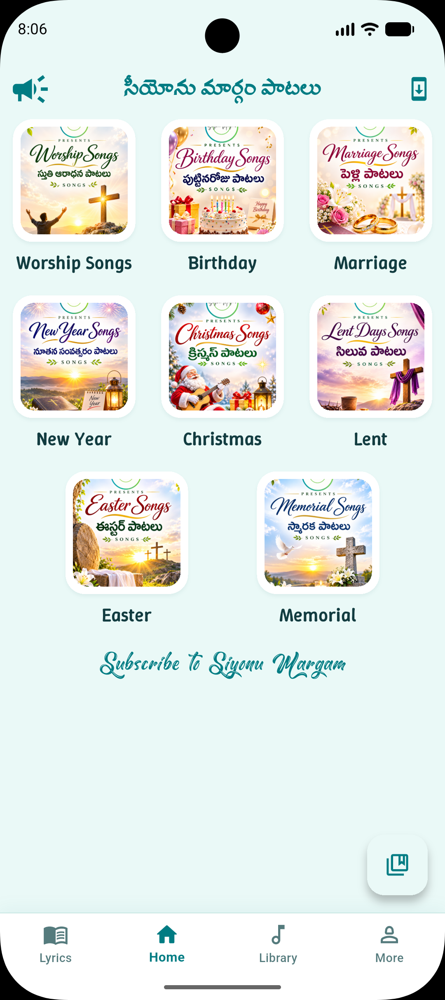
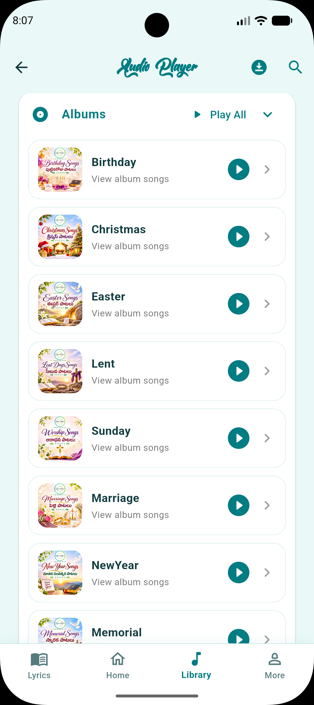
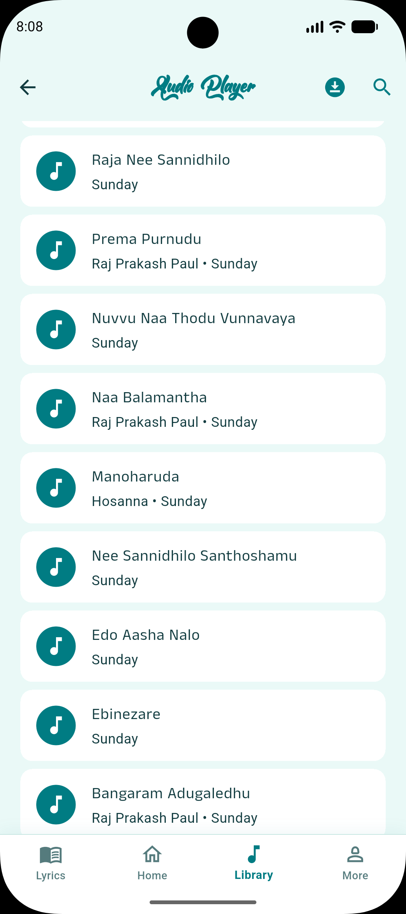
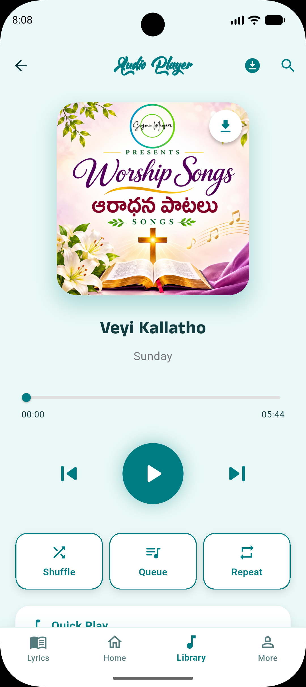
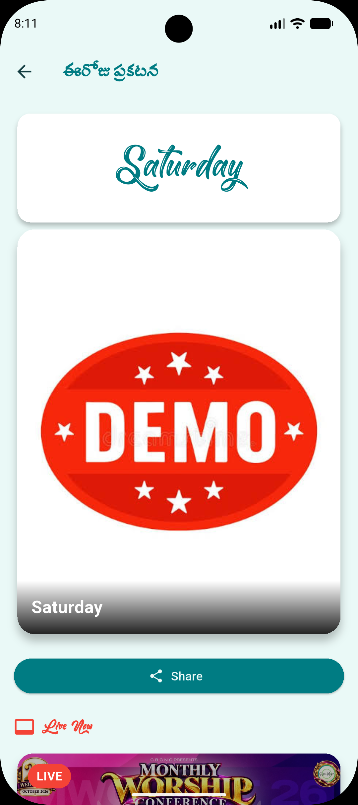
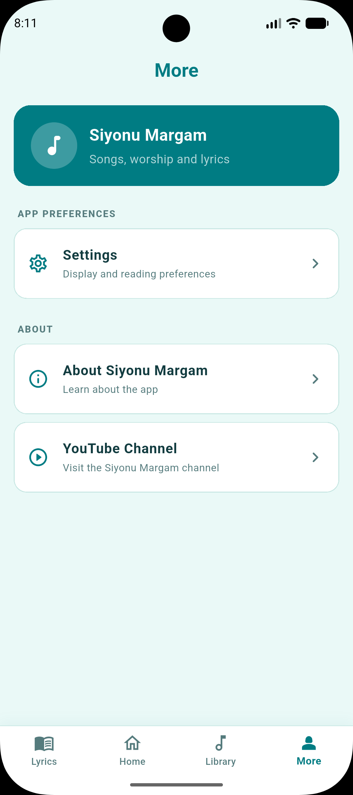
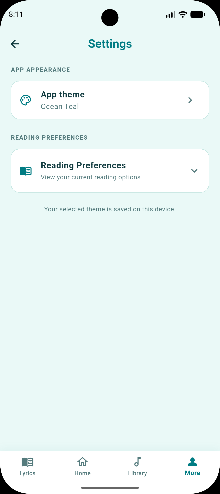
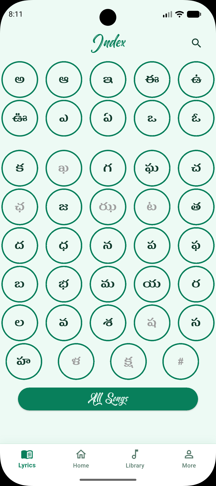
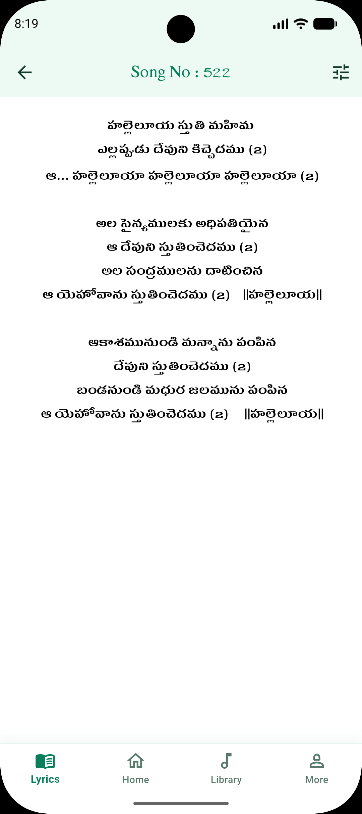
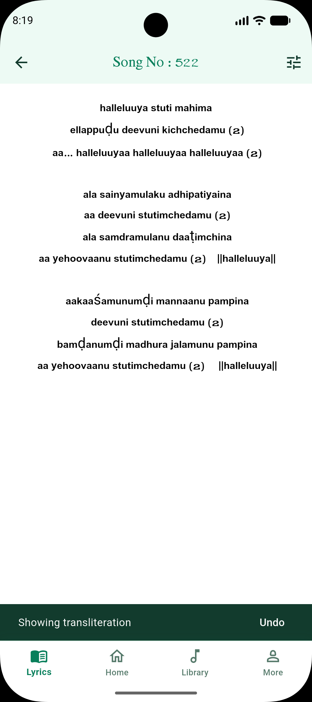

# 🎵 Siyonu Margam – సీయోను మార్గం

### Telugu Christian Songs, Worship & Lyrics Application

A beautifully designed mobile application bringing Telugu Christian worship songs, devotional music and lyrics together in one place.

Siyonu Margam is designed to provide an organized and user-friendly experience for exploring Christian songs, reading Telugu lyrics, listening to worship music and accessing devotional content.

---

## 📱 Application Overview

Siyonu Margam provides a collection of Christian songs organized into different categories and albums, with an integrated music player and Telugu lyrics reading experience.

The application combines music, lyrics, personalization and offline listening features in a single mobile experience.

## ✨ Key Features

- 🎵 **Song Categories:** Explore worship, birthday, marriage, Christmas, Easter, Lent, New Year and other song collections.
- 💿 **Music Library:** Browse albums and their individual songs.
- ▶️ **Audio Player:** Listen to songs with playback controls.
- 📃 **Queue Management:** Manage songs in the playback queue.
- 🔀 **Shuffle & Repeat:** Customize music playback.
- 🔍 **Song Search:** Find songs using Telugu search text.
- 📖 **Telugu Lyrics:** Read organized Telugu Christian song lyrics.
- 🔤 **Telugu Transliteration:** View lyrics in Roman characters.
- 🌐 **Translation Support:** Toggle Telugu/English translation display.
- 🔠 **Reading Preferences:** Adjust lyric text size.
- 🎨 **12 App Themes:** Personalize the application appearance.
- 📥 **Offline Downloads:** Download songs and listen offline.
- 📅 **Daily Content:** Access daily content and worship announcements.
- 📺 **YouTube Integration:** Access the Siyonu Margam YouTube channel.

---

## 🖼️ Application Screenshots

Explore the different screens and features of Siyonu Margam.

### 1. Home & Navigation

The home dashboard provides access to different Christian song collections through illustrated category cards.

| Splash Screen | Home Dashboard |
|---|---|
|  |  |

### 2. Music Library & Playback

Browse albums, explore individual songs and enjoy music through the integrated audio player.

**Album Library**

**Album Songs**

**Music Player**

### 3. Daily Content & Navigation

Access daily content, worship announcements and additional application information.

| Daily Content | More Screen |
|---|---|
|  |  |

### 4. Personalization & App Settings

Customize the application appearance and choose a preferred reading experience.

**Application Settings**

**Theme Selection**

The application offers 12 selectable themes, including:

- Royal Purple
- Ocean Blue
- Forest Green
- Dark Mode
- Evergreen
- Royal Navy
- Burgundy
- Ocean Teal
- Golden Sand
- Lavender
- Slate
- One additional theme

The selected theme is saved on the device.

### 5. Telugu Lyrics & Search

Find songs, browse Telugu lyrics using the alphabet index and read complete song lyrics.

**Telugu Lyrics Index**

**Song Search**

**Telugu Lyrics Reader**

### 6. Reading Experience

The lyrics reading experience includes adjustable text size, translation visibility and Roman transliteration.

**Reading Settings**

**Telugu Transliteration**

### 7. Offline Music & About

**Offline Downloads**

Downloaded songs can be accessed through the downloads screen and played without an active internet connection.

**About Siyonu Margam**

---

## 🎨 UI/UX Design

The application follows a consistent visual design with an emphasis on readability, accessibility and simplicity.

### Design Characteristics

| Element | Design |
|---|---|
| Primary Theme | Ocean Teal |
| Background | Soft Mint |
| Cards | White with rounded corners |
| Typography | Modern text and decorative headings |
| Navigation | Bottom Navigation Bar |
| Artwork | Custom album and category illustrations |
| Personalization | 12 selectable themes |

### Navigation Structure

The application provides four primary navigation destinations:

- **Lyrics:** Browse and read Christian song lyrics.
- **Home:** Explore song categories and collections.
- **Library:** Access albums and music playback.
- **More:** Open settings and application information.

---

## 🛠️ Technology Stack

| Technology | Purpose |
|---|---|
| Flutter | Mobile application development |
| Dart | Application programming language |
| Supabase | Backend services |
| PostgreSQL | Database |
| Supabase Storage | Media and image storage |

---

## 🌟 Project Highlights

Siyonu Margam demonstrates practical mobile application development through:

- Building a structured music application.
- Integrating backend services and database content.
- Developing an audio playback experience.
- Creating a Telugu lyrics reading interface.
- Implementing customizable application themes.
- Supporting offline music downloads.
- Designing a user-friendly mobile interface.

---

## 🚀 Project Status

**Status:** Actively developed.

This repository is a visual project showcase containing application screenshots, feature descriptions and design documentation.

It does not contain the Flutter application source code.

---

## 🙏 About the Project

Siyonu Margam – సీయోను మార్గం brings Telugu Christian songs, worship and lyrics together in one place.

The goal is to make Christian worship music and lyrics accessible through a simple and organized mobile application.

**Thank you for exploring Siyonu Margam!**

